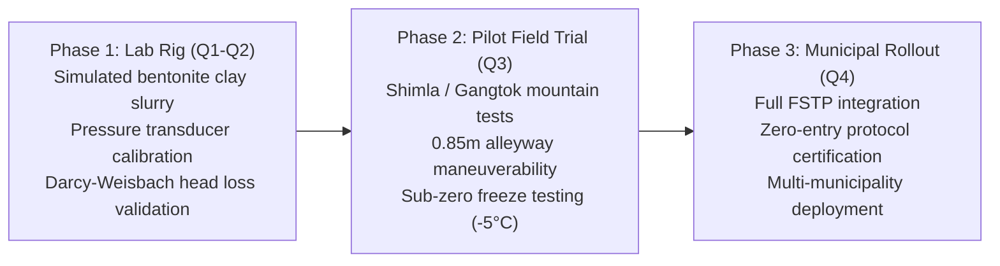

# Future Scope & Physical Field Validation Roadmap

## 1. Physical Sensor Integration & IoT Telemetry Architecture
The next evolutionary phase of the Decision Support System will transition from simulation to a live, edge-instrumented physical system:

1. **Intrinsically Safe (ATEX Zone 0) Gas Sensor Wands**:
   - Integrate Bluetooth Low Energy (BLE) / LoRaWAN wireless gas probes ($H_2S, CH_4, O_2, CO$) mounted directly at the suction nozzle tip, streaming real-time toxic gas telemetry to the operator's handheld interface.
2. **In-Line Dynamic Sludge Viscometer & Pressure Transducers**:
   - Install differential pressure transducers across a calibrated 1.0-metre hose section to compute real-time dynamic viscosity ($\mu$) and shear stress in situ.
   - Automatically throttle engine RPM or trigger fluidization water injection when in-line viscosity spikes.
3. **IMU-Based Chassis Tilt & Winch Load Monitoring**:
   - Mount 6-axis Inertial Measurement Units (IMU) on vehicle and trailer chassis to continuously calculate live roll/pitch angles relative to the calculated critical tip angle ($\theta_{\text{tip}}$), sounding audible rollover proximity alarms if slope exceeds $70\%$ of tip limit.

---

## 2. Advanced Geospatial & Robotic Perception

1. **LiDAR & Photogrammetry Micro-Terrain Mesh Generation**:
   - Replace manual road width and slope estimates with smartphone-based LiDAR point clouds or drone aerial photogrammetry to automatically detect staircase risers, overhead cable clearances, and mud rut depths along the access path.
2. **Autonomous Winch-Tethered Crawler Locomotion**:
   - Implement semi-autonomous winch line tension control for tracked robotic units, allowing motorized winches to dynamically take up cable slack as the crawler navigates steep mountain steps.

---

## 3. Physical Validation Trials Roadmap (3-Phase Plan)

---

## 4. Required Materials & Equipment for Physical Field Validation

To transition from this decision-support prototype to full-scale empirical validation, the following physical components are specified:

1. **Pumping & Fluid Power Test Rig**:
   - Positive displacement progressive cavity pump (0–10 m³/h, 16 bar shutoff head).
   - Variable frequency drive (VFD) 5.5 kW electric motor or Honda GX200 4.3 kW petrol engine.
   - 65 mm and 75 mm food-grade clear spiral-reinforced PVC suction hoses (for flow visualization).
2. **Instrumentation & Data Acquisition (DAQ)**:
   - Rosemount 3051S differential pressure transmitters (0–25 bar).
   - Krohne OPTIMASS Coriolis mass flow meter (for direct slurry density and mass flow measurement).
   - Industrial 4-gas analyzer (Industrial Scientific Ventis Pro5).
   - DataTaker DT80 industrial data logger with 10 Hz sampling rate.
3. **Surrogate Test Slurries**:
   - Bentonite clay / cellulose polymer mixture formulated to match faecal sludge shear yield stress ($\tau_y = 10 - 250 \text{ Pa}$) and Total Solids ($5\% - 25\%$).
