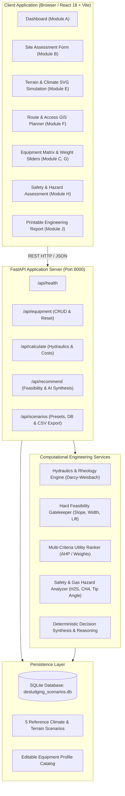

# System Architecture & Technical Specifications

## 1. System Overview & Architectural Paradigm
The **Mechanized Desludging Decision Support System (DSS)** is engineered as a decoupled, modular full-stack engineering platform designed for rapid local deployment without external cloud or paid AI dependencies.

The architecture strictly separates:
- **Presentation & Dynamic Visualization Layer** (React 18, TypeScript, Tailwind CSS, Recharts, Leaflet, SVG engine).
- **Core Engineering & Physical Simulation Services** (Python, FastAPI, NumPy).
- **Persistence & Benchmark Scenario Layer** (Embedded SQLite with ACID transactions).

---

## 2. High-Level Architectural Diagram

---

## 3. Data Flow Diagram (DFD Level 1)

```mermaid
sequenceDiagram
    autonumber
    actor Engineer as Sanitation Systems Engineer
    participant Frontend as React Single-Page Application
    participant API as FastAPI Router
    participant Service as Decision Support & Hydraulic Engine
    participant DB as SQLite Storage

    Engineer->>Frontend: Selects scenario preset or adjusts site parameters (slope, volume, climate)
    Frontend->>API: POST /api/recommend (SiteConditions, EvaluationWeights)
    API->>Service: evaluate_and_rank_catalog(site, weights)
    
    rect rgb(20, 30, 45)
        Note over Service: 1. Compute Sludge Rheology (Density, Viscosity)<br/>2. Apply Climate & Altitude Deratings<br/>3. Compute Total Dynamic Head (TDH) & Power<br/>4. Execute Hard Feasibility Gatekeeper Checks<br/>5. Calculate Multi-Criteria Composite Utility Scores
    end
    
    Service->>API: FullRecommendationResponse (Recs, Safety, AI Narrative)
    API-->>Frontend: JSON Payload
    Frontend-->>Engineer: Live SVG Profile Animation, KPI Gauges, Feasibility Matrix updated
    
    opt Save Scenario
        Engineer->>Frontend: Clicks "Save Scenario"
        Frontend->>API: POST /api/scenarios (Name, SiteConditions, Snapshot)
        API->>DB: INSERT INTO scenarios (...)
        DB-->>Frontend: Scenario ID Created & Catalog Updated
    end
```

---

## 4. Component Hierarchy and Responsibility Mapping

| Module Name | File Location | Core Responsibility |
|---|---|---|
| **App Entry & Navigation** | `frontend/src/App.tsx` `frontend/src/components/Navbar.tsx` | Manages application state, active tabs, preset selectors, API polling, and report print modal. |
| **Interactive Dashboard** | `frontend/src/components/Dashboard.tsx` | Surfaces primary KPIs (cost, time, accessibility, jobs/shift), mini flow charts, and quick-access scenarios. |
| **Site Parameter Config** | `frontend/src/components/SiteAssessmentForm.tsx` | Captures geographic, climatic, rheological, and logistical site inputs; validates physical constraints. |
| **Terrain Simulation SVG** | `frontend/src/components/TerrainSimulationSVG.tsx` | Renders dynamic cross-section slope SVG with hose routing, fluid animation, operational stages, and weather particles. |
| **Route Access GIS** | `frontend/src/components/RouteAccessPlanner.tsx` | Integrates Leaflet OpenStreetMap tiles, waypoints, pinch-point toggles, and tanker vs carry-in comparison. |
| **Equipment Matrix** | `frontend/src/components/EquipmentComparison.tsx` | Side-by-side comparison table, adjustable weight sliders, Cost vs Shift productivity bar chart, and radar profile. |
| **Safety & Hazard Panel** | `frontend/src/components/SafetyPanel.tsx` | Confined-space zero-entry mandate, biogas exposure ratings, critical tip-angle stability meter, PPE matrix, emergency steps. |
| **AI Advisor Card** | `frontend/src/components/AiAdvisorCard.tsx` | Deterministic engineering diagnosis, governing constraints, top choice justification, trade-offs, and design improvements. |
| **Scenario Persistence** | `frontend/src/components/ScenarioManager.tsx` `backend/app/database.py` | SQLite CRUD operations, scenario duplication, deletion, and CSV spreadsheet streaming. |
| **Printable Report** | `frontend/src/components/EngineeringReport.tsx` | Formats complete engineering assessment as clean, printable documentation with formal sign-off blocks. |

---

## 5. Security, Validation, and Computational Guarantees

1. **Zero External API Failure Mode**: The recommendation engine runs 100% locally on standard CPU hardware using deterministic NumPy vectorization. No internet connection or paid token APIs are required.
2. **Physical Boundary Guards**: Inputs exceeding physical limits (e.g., suction lift $> 10.33 \text{ m}$ barometric cutoff, slope $> 45^\circ$, or negative volumes) are rejected at the Pydantic schema validation layer before reaching numerical routines.
3. **Traceability**: All cost figures, power ratings, and flow rates are calculated explicitly through documented mathematical relationships, preventing fabricated estimates.
